# SVSU Knowledge Assistant

Ask questions about a university's official letters, notices, circulars and policies in Hindi, English
or Hinglish, and get answers that cite the exact page and passage they came from.

Built for **Swami Vivekanand Subharti University (SVSU), Meerut**. Staff upload documents once. Many of
them are scanned paper circulars in Hindi and English, often with tables. The assistant reads them,
indexes every paragraph, and from then on answers questions only from those documents. If the records
don't say something, it says so instead of guessing.

**Live (test deployment, staff login required):** https://svsu.54-173-64-109.sslip.io

**📱 Android app:** [download the latest version](https://github.com/Abh1shxkk/svsu-knowledge-assistant/releases/latest)
(free, same account as the website). See [Android app](#android-app) below.

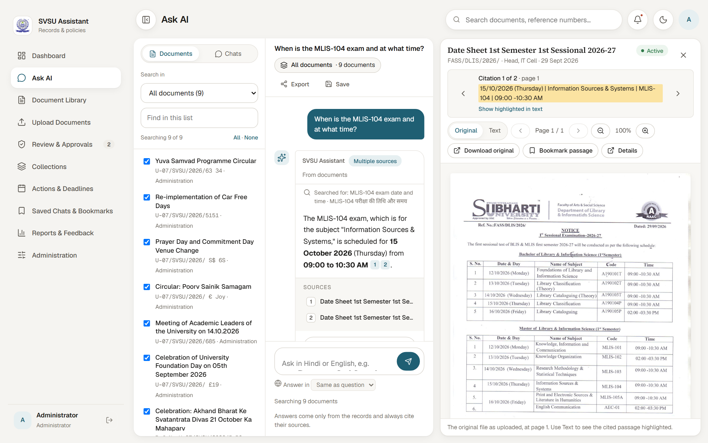

## What it does

- **Answers with proof.** Every statement carries a numbered citation. Clicking it opens the original
  scan at that page, with the passage highlighted.
- **Reads scanned paper.** OCR with Tesseract detects whether each page is Hindi or English, rebuilds
  ruled tables cell by cell (exam date sheets, committee lists) and highlights words it was unsure of
  for a person to check.
- **Hindi, English and Hinglish.** "Staff bus subah kitne baje chalti hai?" gets an answer in Hinglish,
  and a question in Devanagari gets one in Hindi.
- **Streams the answer.** Progress shows at once ("Searching the records…", "Reading 8 passages…") and
  the text appears as it is written.
- **Checks itself.** A second model reads the answer against the cited records and flags any statement
  it can't find there. The answer model is not allowed to add up numbers itself.
- **Knows what is current.** Documents go Draft → Pending → Active, and later Superseded, Withdrawn or
  Expired. Expiry dates are suggested at upload, and expired documents are used only as history.
- **Access control.** Four roles (Administrator, Approver, Uploader, Viewer) and per-document visibility
  levels, enforced by the server for search and answers as well as for pages.
- **Bulk import.** Point it at a folder of thousands of files. A background queue reads, describes,
  de-duplicates and indexes them, with progress and retry.
- **Two-step verification.** Authenticator-app codes with one-time recovery codes. Administrators can
  require it for Administrators and Approvers. Repeated wrong passwords or codes lock sign-in for a few
  minutes.
- **Answer-quality test.** Generates questions from random paragraphs (in English, Hinglish and Hindi),
  runs them through the real pipeline and reports how often the right paragraph was found and the
  answer was correct.

| | |
|---|---|
| 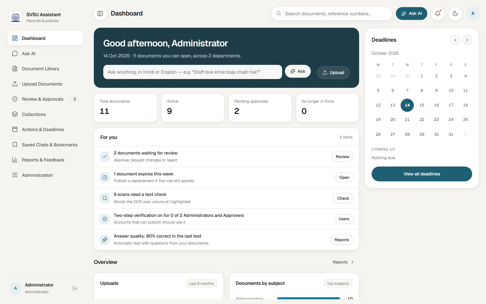 | 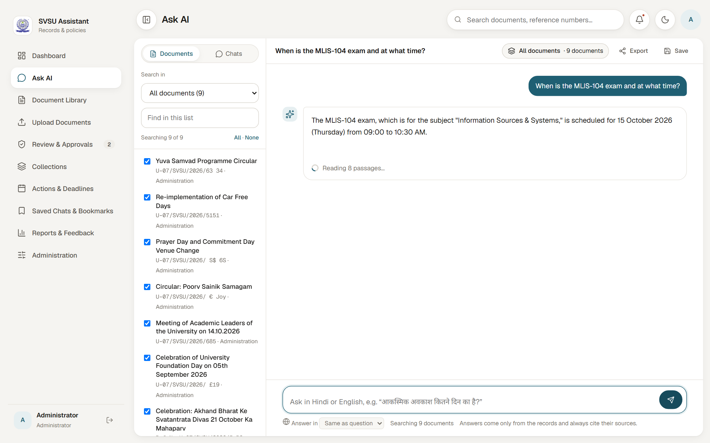 |
| **Dashboard:** ask from the top, with a "For you" list by role | **Streaming:** the answer appears while it is written |
| 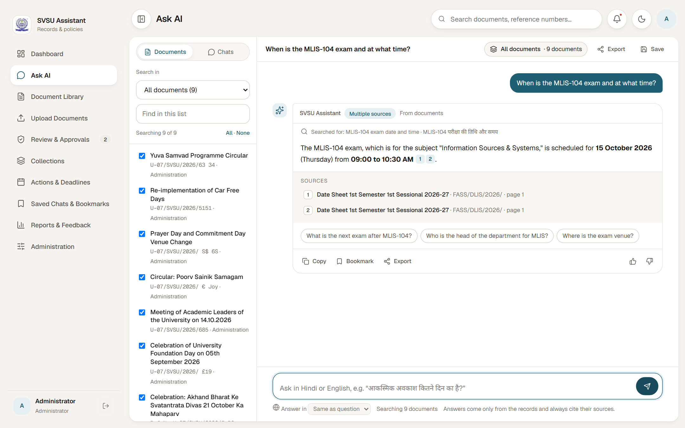 | 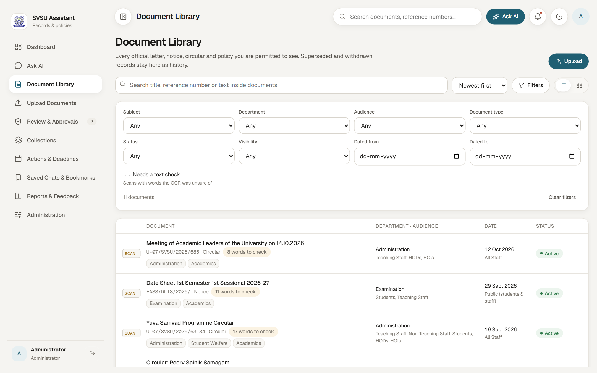 |
| **Answer:** citations, sources and follow-up questions | **Library:** filters, status and OCR words to check |
| 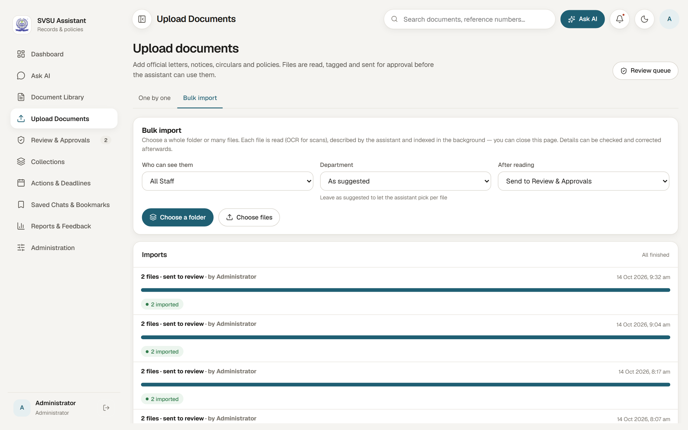 | 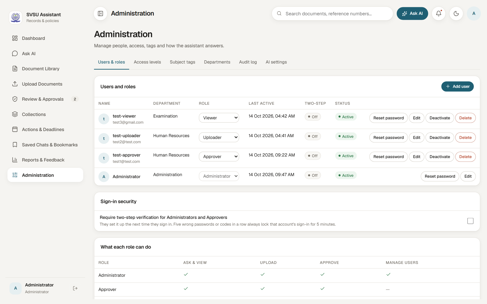 |
| **Bulk import:** a background queue with progress | **Administration:** roles, two-step verification, lock-out |
| 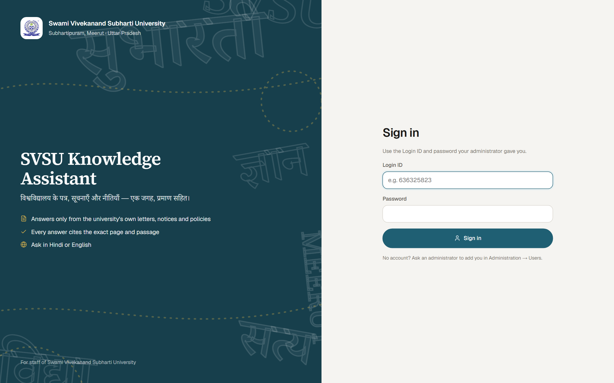 | 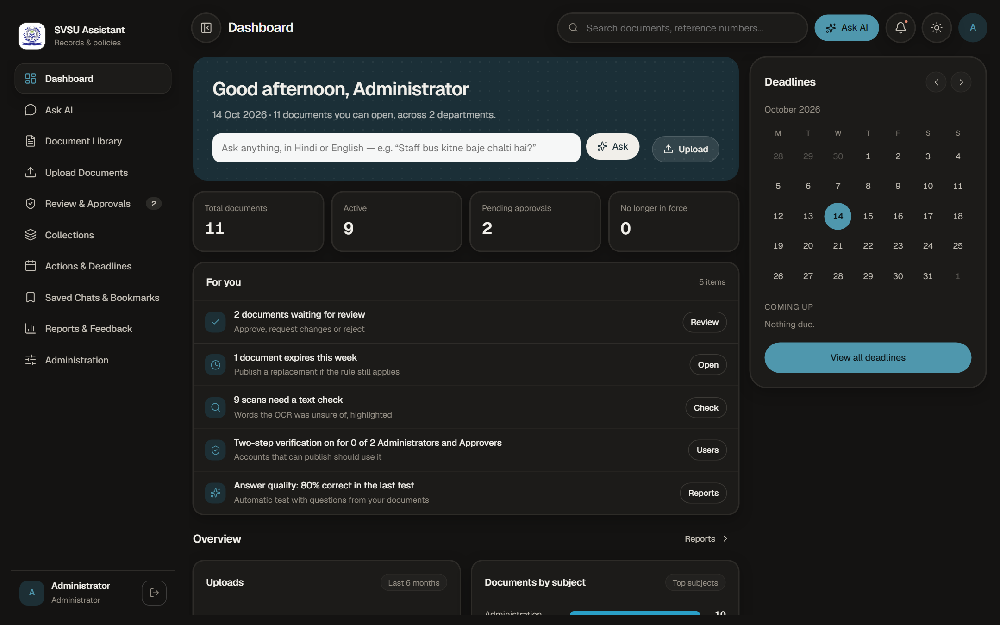 |
| **Sign in** | **Dark mode** |

## Android app

Everything on the website is also in an Android app, built with Flutter. It uses the same server and
the same accounts, so each person sees exactly what their role allows on the web.

| | | | |
|---|---|---|---|
| 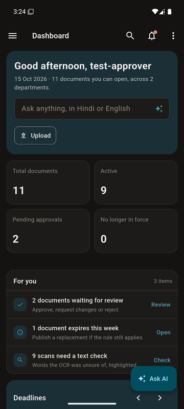 | 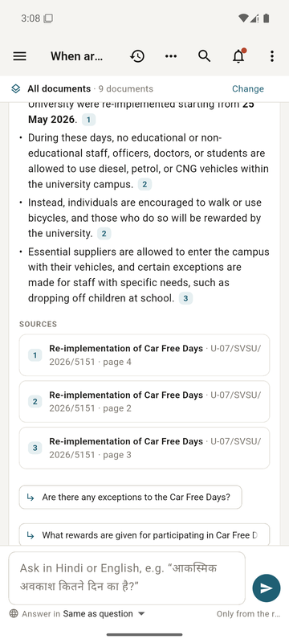 | 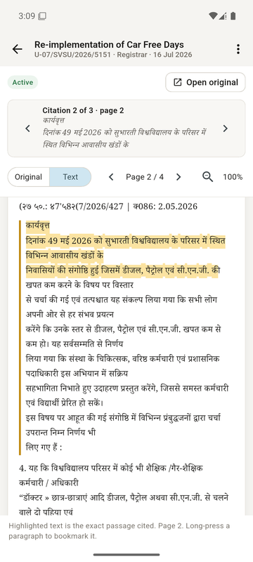 | 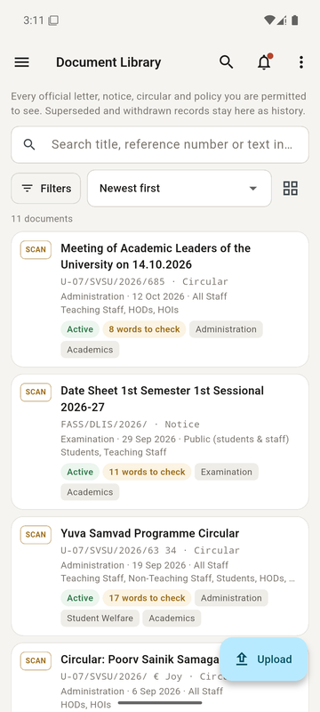 |
| **Dashboard** (dark mode) | **Answer** with sources | **Cited passage** highlighted | **Library** |

**Install:** open the [latest release](https://github.com/Abh1shxkk/svsu-knowledge-assistant/releases/latest)
on an Android phone and download **SVSU-Assistant-…-arm64.apk** (or the *universal* file if that one
won't install). Open it, allow "install unknown apps" when Android asks, and sign in with your website
Login ID and password. The app says when a newer version is available.

Made for phones: long-press a paragraph to bookmark it, photograph a paper letter to upload it (read with
OCR), and open originals and Word exports in the phone's own apps. Details, building and publishing are in
[mobile/README.md](mobile/README.md).

## How it works

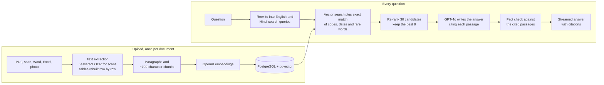

1. **Upload.** Text is read from the file. Scans go through OCR. Ruled tables are found from their
   lines, and each cell is read separately so rows stay together. The text is split into paragraphs,
   with long tables split into pieces that repeat the column headings.
2. **Index.** Each paragraph is embedded once and stored with pgvector (HNSW index). Nothing is OCR'd
   or re-read at question time.
3. **Search.** A small model rewrites the question into English and Hindi queries. Meaning-based search
   is fused with exact matching of codes like `MLIS-104`, dates written as on the documents, and the
   question's rare words (reciprocal rank fusion). Searches only cover documents the person may see.
4. **Re-rank.** About 30 candidates are scored by a small model against the question, and the best 8
   are read along with the paragraphs around them.
5. **Answer and check.** GPT-4o writes the answer from those passages only, citing each one. A second
   reading flags statements the cited passages don't support.

The LLM never searches. It only rewrites the question, ranks candidates, writes from given passages and
checks the result.

## Tech stack

| Layer | Tools |
|---|---|
| Frontend | Next.js 16, React 19, TypeScript, Zustand, plain CSS with light and dark themes |
| Android app | Flutter 3.47 (Dart), go_router, streamed answers over the same API, token in secure storage |
| Backend | Python 3.11, FastAPI, SQLAlchemy, server-sent events for streaming |
| Data | PostgreSQL 16 with pgvector (HNSW cosine index), JSONB records |
| AI | OpenAI `gpt-4o` (answers), `gpt-4o-mini` (query rewrite, re-ranking, fact check, test judge), `text-embedding-3-small` |
| OCR and files | Tesseract (`eng`, `hin`, `osd`), PyMuPDF, python-docx, openpyxl, NumPy |
| Security | bcrypt passwords, JWT sessions, TOTP two-step verification (pyotp), role and visibility policy on every request |
| Testing | pytest (65 API tests on a separate database, OpenAI stubbed), Playwright (12 browser tests against the live site), Flutter widget tests (every app screen, on a phone-sized screen) |
| Hosting | AWS EC2 (Ubuntu), Docker Compose, Caddy (automatic HTTPS), GitHub Actions |

## Deployment and CI/CD

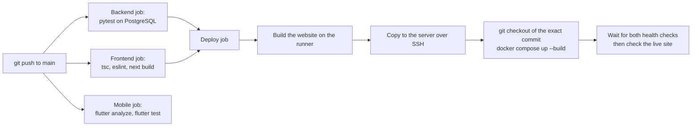

- **Server:** one AWS EC2 Ubuntu machine shared with other apps. Three containers: `pgvector/pgvector:pg16`,
  the FastAPI API (Tesseract installed in the image) and the Next.js standalone server on Node 22. Each has
  a memory limit. Containers only listen on `127.0.0.1`, and **Caddy** serves them over HTTPS (`/api/*` →
  API, everything else → website).
- **Pipeline** (`.github/workflows/ci.yml`): every push runs the backend tests, the frontend type check,
  lint and production build, and the Android app's analyzer and tests (the app job doesn't hold up a deploy). On `main`, the deploy job:
  1. builds the website on the GitHub runner, so the small server doesn't have to;
  2. copies it over SSH;
  3. checks out the exact commit on the server and rebuilds the containers;
  4. waits for both health URLs, then requests the live site.
  
  Old images are pruned, and the previous website build is kept for a quick rollback.
- **Database access** for administrators is through an SSH tunnel only; the database port is never public
  (see [deploy/README.md](deploy/README.md)).
- **Background work** runs in the API process: a job queue (`SELECT … FOR UPDATE SKIP LOCKED`) for bulk
  imports and quality tests, and an hourly job that expires documents and sends deadline reminders.

## Run it locally

```bash
# backend
cd backend
python -m venv .venv && .venv\Scripts\activate
pip install -r requirements.txt
copy .env.example .env          # set OPENAI_API_KEY (an administrator can also set it in the app)
uvicorn app.main:app --port 8000

# frontend
cd frontend
npm install
npm run dev                     # http://localhost:3000
```

- **Tesseract:** needs `eng`, `hin` and `osd` language files in `TESSDATA_DIR`.
- **Database:** leave `DATABASE_URL` blank and a local PostgreSQL 16 starts with its data in
  `D:\PostgreSQL\data`. In production, point `DATABASE_URL` at a server with the `vector` extension.
- **First administrator:** create it from the `backend` folder; the password is typed at a hidden
  prompt:

  ```bash
  python -m app.cli create-admin --login-id <login id> --name "<full name>" --dept "<department>"
  ```

  Everyone else is added in **Administration → Users & roles**.
- **Other commands:**
  - `python -m app.cli import-folder <folder> --by <login id>` imports a whole folder.
  - `python -m app.cli evaluate -n 50 --new` runs the answer-quality test.
  - `python -m app.cli backup` dumps the database.

## Tests

```bash
cd backend && python -m pytest -q                   # 65 API tests, offline, on database svsu_test
cd frontend && npx playwright test                  # browser tests; needs E2E_BASE_URL, E2E_API_URL,
                                                    # E2E_ADMIN_ID, E2E_ADMIN_PASS
cd mobile && flutter test                           # Android app: every screen against backend/seed.json
```

## Project docs

- [docs/QUALITY-PLAN.md](docs/QUALITY-PLAN.md): answer quality, speed and sign-in security, with results
  from real circulars.
- [docs/FIXES.md](docs/FIXES.md): the security and correctness review and what was fixed.
- [deploy/README.md](deploy/README.md): server set-up, manual deploy, rollback, database tunnel.
- [mobile/README.md](mobile/README.md): the Android app: install, build, publish a new version, signing key.
